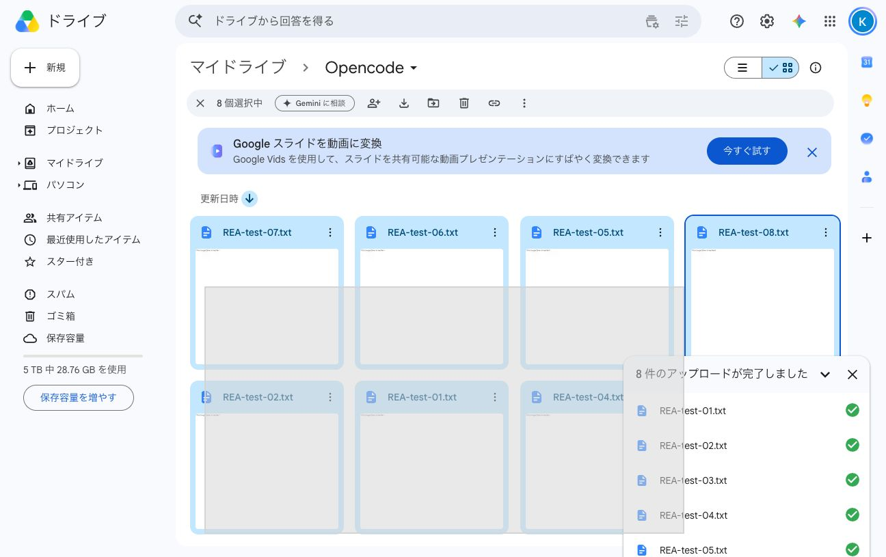
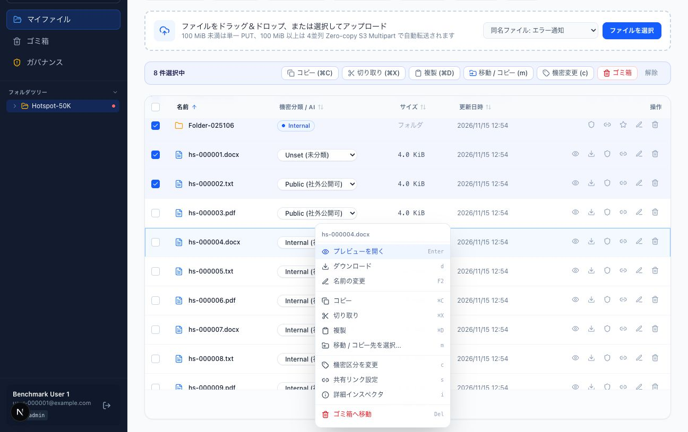
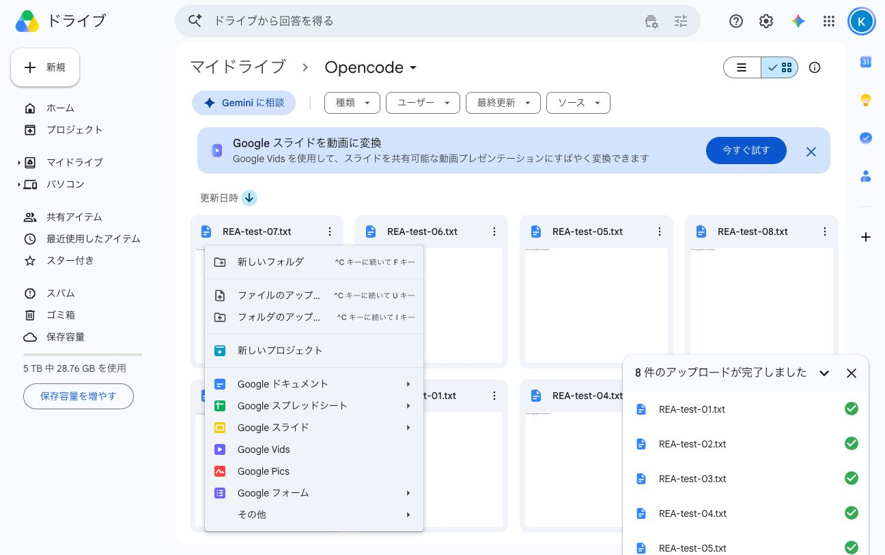
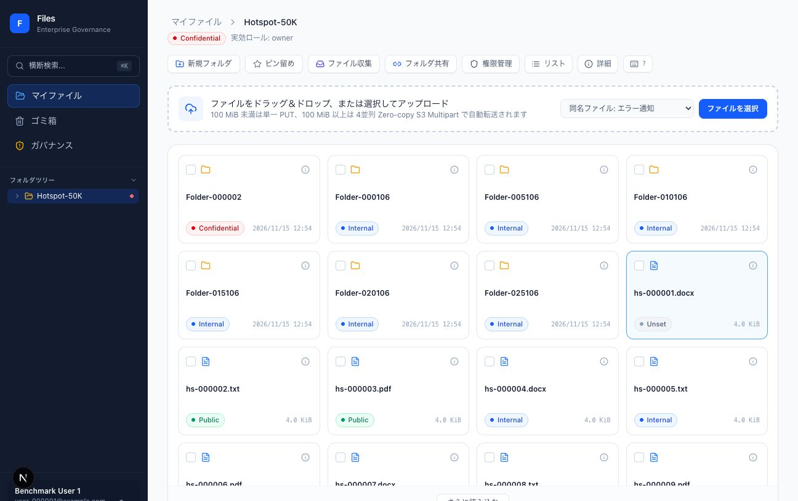
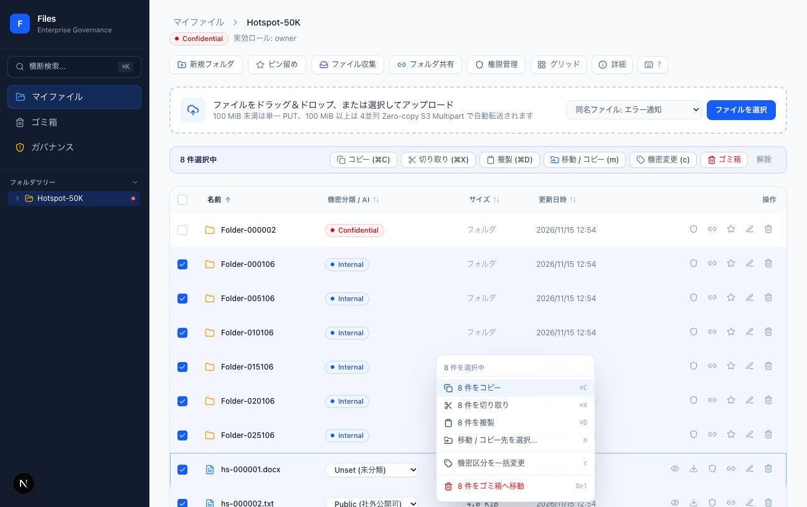

# Google Drive vs Files — マウス操作性の比較レポート

- 実施日: 2026-11-15
- Google Drive: `Opencode` フォルダ（`1XNzT-KNBIa6ucfs7vK4YcdlLqiFcpqHk`）にテスト用 `.txt` 8件を作成して実機観察（観察後に削除済み・ゴミ箱）
- Files: ローカル開発環境 `http://localhost:3000/workspace?folderId=folder-000001`（Hotspot-50K／約5万件のシードデータ）に `sys_admin` でサインインして実機観察
- 手法: デスクトップ Chromium 上で実 UI を操作し、DOM / ARIA (`aria-selected`, `role="menu"`) とスクリーンショットで証跡化。コードは `apps/web/src/components/WorkspaceFileBrowser.tsx` ほかを照合

> 注: Google Drive の UI はアカウント・実験グループ・時期で変わる。ここに記すのは 2026-11-15 時点の日本語 UI での観察結果。

---

## 0. 結論（先に要点）

Files は Phase 6 で DnD・コンテキストメニュー・キーボード操作を実装済みで、**「機能の有無」では Google Drive にかなり近い**。しかし **マウス選択の基本モデルが Drive と根本的に違う**ため、日常操作で明確に劣る。

| 優先 | 欠落・不整合 | 影響 |
|---|---|---|
| **P0** | 行・カードの**シングルクリックで選択できない**（16px のチェックボックスのみ） | 「クリックして選ぶ」という最も基本的な操作が成立しない。選択のたびに小さな的を狙う必要がある |
| **P0** | **Cmd/Ctrl+クリック**で行をトグルできない | 飛び石の複数選択がチェックボックス頼み。Excel/Finder/Drive の筋肉記憶が使えない |
| **P0** | **右クリックした行と選択状態が不一致** | 8件選択中に別の行を右クリックすると、8件のハイライトを残したまま「その1件」のメニューが開く。削除・コピー・移動の対象が直感とズレる |
| **P1** | **マーキー（ラバーバンド）選択がない** | 空白からドラッグして矩形で複数選択できない。大量選択が Shift+クリックの往復になる |
| **P1** | **空白クリックで選択解除できない／空白右クリックメニューがない** | 「何もない所をクリックして解除」「右クリックから新規作成・貼り付け」ができない |
| **P1** | **ファイル名のシングルクリックでプレビューが開く** | 「選択したいだけ」のつもりがプレビュー/フォルダ移動になる。Drive はシングルクリック＝選択、開くはダブルクリック/Enter |
| **P2** | 矢印キーが**選択を動かさずフォーカスだけ動く** | キーボードで「次のファイルを選ぶ」ができない。Drive はフォーカスと選択が一緒に動く |
| **P2** | 行アクションが**常時5〜7アイコン**＋チェックボックス | 名前列が狭く、視線・クリック対象が散らかる。Drive は1つの「その他の操作」に集約 |
| **P2** | コンテキストメニューが**フラット**で情報設計が弱い | 版管理・アクティビティ・ロック・新しいタブ・アプリで開く等がなく、項目が増えると破綻する |

---

## 1. 操作モデルの比較（実測サマリ）

| 操作 | Google Drive（実測） | Files（実測 / コード） | 判定 |
|---|---|---|---|
| 行・カードのシングルクリック | その行だけ選択（他は解除） | **無反応**（フォーカスだけ。名前クリックは開く） | ✗ |
| Cmd/Ctrl+クリック | 選択をトグル（追加/解除） | **行では無反応**。16px チェックボックス上のみ可 | ✗ |
| Shift+クリック | アンカーから範囲選択 | 行でも範囲選択できるが、**アンカーはチェックボックス/Shift クリック時のみ設定** | △ |
| 空白からのドラッグ | **マーキー選択**。矩形が表示され、ドラッグ中にライブ更新 | **未実装**（選択も矩形も出ない） | ✗ |
| 空白クリック | 選択解除 | 選択解除されない | ✗ |
| 空白右クリック | 新規フォルダ / アップロード / Google アプリ作成メニュー | メニューなし | ✗ |
| 未選択行を右クリック（複数選択中） | その行だけ選択し直してメニュー | 選択は元のまま、メニューは右クリック行単体 | ✗ |
| 選択済み行を右クリック（複数選択中） | 複数選択を維持してメニュー | 複数選択を維持し、一括メニュー | ○ |
| 行のオーバーフロー | 1つの「その他の操作」（3点） | 常時 5〜7 アイコン + チェックボックス | △ |
| 矢印キー | フォーカスと選択が一緒に移動 | フォーカスのみ移動、選択は残る | △ |
| Shift+矢印 | 範囲を拡張 | 範囲を拡張 | ○ |
| Cmd+A / Esc | 全選択 / 解除 | 全選択 / 解除 | ○ |
| グリッドカードのクリック | 選択 | **無反応**（チェックボックスのみ） | ✗ |
| 右クリックメニュー | サブメニュー（アプリで開く / 共有 / 整理 / 詳細） | フラット。版管理・ロック・新しいタブ等なし | △ |

---

## 2. Files が劣っている点（詳細）

### 2.1 行クリックで選択できない（最重要）

**Google Drive**: 行のどこをクリックしても、その行だけが選択され、他の選択は解除される。選択は行全体の淡いブルーの帯で示され、クリック対象は行全体（約48px 高）。

**Files**: `<tr>` の `onClick` は `setFocusedRowKey` と **Shift 時の範囲選択だけ**を処理し、通常クリックでは選択を変えない。

```tsx
// apps/web/src/components/WorkspaceFileBrowser.tsx（表の行）
onClick={(e) => {
  if (isInlineRenaming) return;
  setFocusedRowKey(rowKey);
  if (e.shiftKey && rowSelectable) {
    setSelectedKeys(selectKeyRange(orderedRowKeys, selectionAnchorKey ?? rowKey, rowKey));
    ...
  }
}}
```

選択できるのは行頭の **16×16px のチェックボックス**だけ。チェックボックスの `onClick` は `toggleKeySelection` を呼ぶため、素のクリックが「追加選択」になり、Drive の「素のクリック＝排他選択」とも違う。

- 実測: 8件選択中に別の行の本文をクリック → 選択は8件のまま、フォーカスも行に移らない
- 実測: グリッドのカード本文をクリック → 選択0件のまま、URL も変わらない

**なぜ問題か**: ファイル管理 UI の最初の学習は「クリックで選ぶ」。チェックボックスだけが選択手段だと、行が大きいのに当たり判定が16pxしかなく、タッチ/トラックパッド/高DPI で特に使いにくい。Drive の「行全体が選択ターゲット」は合理的。

---

### 2.2 Cmd/Ctrl+クリックが効かない

**Google Drive**: Cmd（macOS）/ Ctrl（Windows）を押しながら行をクリックすると、その行だけ選択がトグルされる。飛び石選択の標準操作。

**Files**: 行の `onClick` に `metaKey` / `ctrlKey` の分岐がない。チェックボックスを Cmd+クリックすると「普通のクリック」としてトグルするだけなので、結果的に使えるが、**16px のチェックボックスを狙う必要がある**。行の本文では何も起きない。

- 実測: 3件選択中に Cmd+クリック（行本文）→ 3件のまま
- 実測: チェックボックスなら Cmd+クリックでもトグルする（が、修飾キーは実質無視）

---

### 2.3 Shift+クリックは動くが、アンカーが不整合

**Google Drive**: 直前にクリックした行がアンカーになり、Shift+クリックでその行から範囲選択。Cmd+クリックでアンカーが更新される。

**Files**: Shift+クリック自体は `selectKeyRange` で動く（実測: 8件選択）。ただし `selectionAnchorKey` は

- チェックボックスのクリック時
- Shift+クリック時

にしか設定されない。**通常の行クリックではアンカーが更新されない**ため、チェックボックスで選択 → 別の行を Shift+クリック、のような操作で意図しない範囲になることがある。

また、行クリック時の Shift 分岐は `if (!selectionAnchorKey) setSelectionAnchorKey(rowKey)` としており、アンカー未設定ならその行をアンカーにして「1件選択」になる。Drive の「Shift+クリックで直前のクリック位置から範囲」と揃えるなら、通常クリックでもアンカーを更新する必要がある。

---

### 2.4 マーキー（ラバーバンド）選択がない

**Google Drive（実測）**:

- リスト表示で空白からドラッグ → 矩形の範囲に入った行がライブで選択される。部分ドラッグで下5件（08, 02, 01, 04, 03）だけ選択できることを確認
- グリッド表示で空白からドラッグ → **半透明の矩形が表示され**、8枚のカードが選択されることを確認（下図）



**Files**: スクロールコンテナの背景に pointerdown ハンドラがなく、ドラッグしても選択も矩形も出ない（実測: 選択数 1 → 1 のまま、オーバーレイなし）。

既存の `drag-drop-controller.ts` は**行の上で始まる DnD**（6px 閾値）だけを扱う。マーキーは「行の外（背景）で始まるドラッグ」なので、既存 DnD と衝突しない追加実装が可能。

---

### 2.5 右クリックした行と選択状態が不一致（危険）

**Google Drive（実測）**:

- 2件選択 → 未選択の行を右クリック → **選択がその1件に置き換わる**（`before: [06, 05]` → `after: [02]`）
- 3件選択 → 選択済みの行を右クリック → 3件の選択を維持したままメニュー

**Files（実測）**:

- 8件選択 → 未選択の `hs-000004.docx` を右クリック → **8件のハイライトと「8 件選択中」はそのまま**、メニューは `hs-000004.docx` 単体の内容



コード上も、行の `onContextMenu` は `setFocusedRowKey(rowKey)` と `setContextMenu(...)` だけで、`setSelectedKeys` を呼ばない。メニューの対象は `resolveTargetRows(contextMenu.row, selectedRows)` が決めるため、右クリック行が選択外なら **`[primaryRow]` 単体**になる。

```ts
// apps/web/src/lib/workspace-actions.ts
export function resolveTargetRows(primaryRow, selectedRows) {
  if (!primaryRow) return [...selectedRows];
  const primaryKey = rowToKey(primaryRow);
  const isPartOfSelection = selectedRows.some((r) => rowToKey(r) === primaryKey);
  if (isPartOfSelection && selectedRows.length > 0) return [...selectedRows];
  return [primaryRow];   // ← 表示上の選択は8件のまま、対象は1件
}
```

**なぜ危険か**: 削除 (`trash`) は `targets` をループするため、**8件選択中に別の行を右クリック → 削除すると、その1件だけ削除され、選択は全解除**される。ユーザーは「8件を消す」つもりだったのに1件しか消えない。逆に、対象が「選択全体」だと思って別の行を右クリックした場合、メニューの文言（「8 件を…」ではなく単数）と選択表示が矛盾する。

**Drive の解決**: 右クリック時に「選択外ならその行を選択し直す」という**選択の正規化**を先に行う。Files も `onContextMenu` の先頭で同じことをすればよい。

---

### 2.6 空白領域のクリック／右クリック

**Google Drive（実測）**:

- 空白クリック → 選択解除（0件）
- 空白右クリック → フォルダメニューが開く。項目は「新しいフォルダ」「ファイルのアップロード」「フォルダのアップロード」「新しいプロジェクト」「Google ドキュメント / スプレッドシート / スライド / Vids / Pics / フォーム」「その他（図形描画 / マイマップ / サイト / マークダウン / AI Studio / Apps Script）」。選択中の項目は維持される



**Files（実測）**:

- 空白クリック → 選択は残る（`1 → 1`）
- 空白右クリック → メニューなし
- コード上も、スクロールコンテナや `<main>` に背景用のクリック/コンテキストメニューハンドラがない

**なぜ問題か**: 「何もない所をクリックして解除」「右クリックから新規作成・貼り付け」はファイルマネージャーの基本。特に大きいフォルダで「選択を全部やめたい」ときに Escape を覚える必要がある。

---

### 2.7 ファイル名のシングルクリックで開いてしまう

**Google Drive**: 行のクリックは選択。開くのはダブルクリックまたは Enter（フォルダも同じ）。

**Files**:

- ファイル名のボタン `onClick` → `openPreviewForFile(file)`（シングルクリックでプレビュー）
- フォルダ名のボタン `onClick` → `router.push('/workspace?folderId=...')`（シングルクリックで移動）

```tsx
// ファイル名
onClick={(e) => {
  if (e.shiftKey || isPendingUpload) return;
  openPreviewForFile(file);   // ← シングルクリックで開く
}}

// フォルダ名
onClick={(e) => {
  if (e.shiftKey) return;
  router.push(`/workspace?folderId=${encodeURIComponent(folder.id)}`);
}}
```

**なぜ問題か**: ユーザーは「選択したい」だけでも名前をクリックする。Drive の筋肉記憶だと、シングルクリックでプレビュー/フォルダ移動が起きるのは驚き。特にフォルダ移動はコンテキストが切り替わるので、戻る操作が必要になる。

推奨は **シングルクリック＝選択、ダブルクリック＝開く、Enter＝開く**。名前の横に「開く」専用のアイコン（`↗` / `Enter`）を置くと、1クリックで開きたいパワーユーザーも満たせる。

---

### 2.8 グリッドカードのクリックが無反応

**Google Drive**: カードのどこをクリックしても選択。Cmd/Ctrl+クリックでトグル、Shift+クリックで範囲、空白からマーキー。

**Files**: カードの `onClick` は Shift 時のみ範囲選択。通常クリックでは何も起きない（実測: 選択0件のまま、URL 不変）。チェックボックスか、名前/情報ボタンしか反応しない。



---

### 2.9 矢印キーが選択を動かさない

**Google Drive（実測）**: ArrowDown でフォーカスが次の行に移り、**選択もその行に移る**（単一選択に収束）。Shift+ArrowDown で範囲拡張。

**Files**: `moveFocusTo` は `setFocusedRowKey` とスクロールだけ。`extendRange` が true のときだけ選択を更新する。つまり **素の矢印はフォーカス移動のみ**で、選択は元の行に残る。`x` キーでトグル、Space でプレビューという追加操作はあるが、Drive/Finder の「矢印で選択が動く」に慣れたユーザーには戸惑う。

```tsx
const moveFocusTo = (nextIdx: number, extendRange: boolean) => {
  const nextKey = orderedRowKeys[nextIdx];
  if (!nextKey) return;
  if (extendRange && !isTrashView) {
    ... setSelectedKeys(selectKeyRange(...));
  }
  setFocusedRowKey(nextKey);
  ...
};
```

---

### 2.10 行アクションの密度が高い

**Google Drive**: 各行の右端に「その他の操作」（3点）が1つ。クリックでメニューが開き、中に「アプリで開く」「ダウンロード」「名前を変更」「共有」「整理」「詳細」などが集約される。

**Files**: ファイル行に **7個**（プレビュー / ダウンロード / 権限 / 共有リンク / スター / 名前変更 / ゴミ箱）、フォルダ行に **5個** のアイコンが常時表示。さらに行頭にチェックボックス。合計8個のクリック対象が横に並ぶ。



**なぜ問題か**:

- 名前の表示幅が狭くなる
- アイコン同士が近く、誤クリック（特に削除）のリスク
- 視線が散らかり、重要な「名前」と「分類」が埋もれる
- キーボードのタブ移動が行ごとに8回必要

Drive のように **1つのオーバーフローに集約**し、よく使う1〜2個（ダウンロード/共有）だけ残すのが良い。ホバー/フォーカス時だけ表示する案もあるが、Drive は3点自体を常時表示しているので、まずは「数を減らす」方が効果的。

---

### 2.11 コンテキストメニューの情報設計

**Google Drive（実測）** の1ファイルメニュー:

- アプリで開く ▸（プレビュー / 新しいタブで開く / Text Editor / DocHub / Zoho Writer / 他のアプリを接続 / パソコン上のアプリ）
- ダウンロード
- 名前を変更 `⌥⌘E`
- コピーを作成 `⌘C` → `⌘V`
- Gemini に相談
- 音声解説を作成
- 共有 ▸（共有 `⌥⌘A` / リンクをコピー）
- 整理 ▸（移動 `⌥⌘M` / ショートカットを追加 `⌘R` / スターを付ける `⌥⌘S`）
- ファイル情報
- 詳細 ▸（詳細 / セキュリティの制限 / アクティビティ / 版を管理 / ロック）
- ゴミ箱に移動 `Delete`

**Files** のメニュー:

- プレビューを開く `Enter`
- ダウンロード `d`
- 名前の変更 `F2`
- コピー `⌘C` / 切り取り `⌘X` / 複製 `⌘D`
- 移動 / コピー先を選択... `m`
- 機密区分を変更 `c`
- 共有リンク設定 `s`
- 詳細インスペクタ `i`
- ゴミ箱へ移動 `Del`

**Files にないもの**: サブメニュー、新しいタブで開く、アプリで開く、スター（ファイル）、ショートカット追加、版管理、アクティビティ、セキュリティの制限、ロック、オフラインで使用可能。**Files 独自の良さ**: 機密区分、複製、詳細インスペクタ、AI提案承認。これらは残す。

フラットなメニューは項目が11個あり、まだ読めるが、Phase 7 で「ロック」「版管理」「同時編集」が加わると破綻する。今のうちに **「共有」「整理」「詳細」のサブメニュー化** を入れておきたい。

---

## 3. Files が優れている点（公平のため）

- **一括選択バー**が明示的で、「N 件選択中」「N 件をコピー」「N 件を切り取り」「N 件を複製」「N 件を移動/コピー」「機密変更」「ゴミ箱」「解除」が1か所にまとまる。Drive のツールバーより操作の discoverability が高い
- **一括コンテキストメニュー**: 選択済みの行を右クリックすると「N 件を選択中」ヘッダ付きの一括メニューが出る（Drive は単数項目のまま）
- **インライン分類変更**: 一覧のセルで機密区分を直接変更できる。Drive にはないガバナンス UX
- **AI 提案の一括承認**、**詳細インスペクタ**、**権限管理**、**ピン留め**、**ファイル収集**など、エンタープライズ向けの独自機能
- **DnD**: Pointer Events のゴースト、仮想スクロール中のセッション維持、ツリー/パンくず/ピン留めへのマルチドロップ、スプリングロード。Drive と同等以上
- **キーボード**: ⌘K、IME ガード、`KeyboardScopeStack`、F2、⌘C/X/V/D、Shift+F10、Space プレビュー、Esc 解除。Drive にない配慮もある
- **仮想スクロール**: 5万件でも軽快。Drive も同等だが、Files は 0ms 楽観 UI と IndexedDB 同期を持つ

つまり **足りないのは「選択のマウスモデル」と「空白領域の扱い」**であり、機能全体を作り直す必要はない。

---

## 4. 改善提案（優先順）

### P0-1. 行・カードの選択モデルを Drive 互換にする

**対象**: `WorkspaceFileBrowser.tsx` の表の行（`<tr onClick>`）、グリッドカード（`<div onClick>`）、`handleRowSelectionClick`

**仕様**:

| 入力 | 動作 |
|---|---|
| 素のクリック | その行だけ選択（`new Set([key])`）、アンカー更新、フォーカス更新 |
| Cmd/Ctrl+クリック | トグル（`toggleKeySelection`）、アンカー更新、フォーカス更新 |
| Shift+クリック | アンカーから `selectKeyRange`、アンカーは維持 |
| ダブルクリック | 開く（フォルダ移動 / ファイルプレビュー） |
| 名前のシングルクリック | 選択のみ（開かない） |
| チェックボックス | トグル（現状維持）。`stopPropagation` で行クリックと二重発火しない |
| 操作アイコン/メニュー/入力欄 | 選択処理をスキップ（`closest('[data-workspace-row-trigger],button,a,input,[role="menu"]')`） |

**実装イメージ**:

```tsx
function handleRowMouseSelect(e: React.MouseEvent, rowKey: string) {
  if (!rowSelectable) return;
  if (isInteractiveTarget(e.target)) return; // ボタン・入力・リンク
  setFocusedRowKey(rowKey);
  if (e.shiftKey) {
    setSelectedKeys(selectKeyRange(orderedRowKeys, selectionAnchorKey ?? rowKey, rowKey));
    return;
  }
  if (e.metaKey || e.ctrlKey) {
    setSelectedKeys((prev) => toggleKeySelection(prev, rowKey));
    setSelectionAnchorKey(rowKey);
    return;
  }
  setSelectedKeys(new Set([rowKey]));
  setSelectionAnchorKey(rowKey);
}
```

- 表の行とグリッドカードの両方で同じハンドラを使う
- 行の `onDoubleClick` を追加し、`openPreviewForFile` / `router.push` を呼ぶ
- 名前ボタンは `onClick` を選択に変更し、`onDoubleClick` で開く。1クリックで開く導線が欲しければ、名前の横に `↗` アイコンボタンを追加
- `aria-selected` を行/カードに付与し、`aria-multiselectable="true"` をグリッド/テーブルに付ける

**受け入れ基準**:
- 行の任意の位置（名前含む）をクリック → 1件だけ選択
- Cmd/Ctrl+クリック → 追加/解除
- Shift+クリック → 直前クリックから範囲
- ダブルクリック → 開く
- Playwright E2E で上記を検証

---

### P0-2. 右クリック時に選択を正規化する

**対象**: 表の行 / グリッドカード / `Shift+F10` の `setContextMenu`

**仕様**:

1. 右クリックした行が `selectedKeys` に含まれる → そのまま
2. 含まれない → `setSelectedKeys(new Set([rowKey]))`、`setSelectionAnchorKey(rowKey)`
3. 常に `setFocusedRowKey(rowKey)`
4. その後 `setContextMenu({ x, y, row })`

これで `resolveTargetRows` の結果と画面表示が一致し、削除・コピー・移動の対象が WYSIWYG になる。

`Shift+F10` も同じ正規化を通す。現在は `focusedRow ?? selectedRows[0]` を使っており、8件選択中に別の行にフォーカスがあると同じ不整合が起きる。

**受け入れ基準**:
- 8件選択 → 未選択行を右クリック → 選択が1件に置き換わる
- 8件選択 → 選択済み行を右クリック → 8件の一括メニュー
- Delete の対象がメニュー表示と一致
- Playwright E2E で「8件選択 → 別行を右クリック → 削除 → 1件だけ消える」を明示的に検証（回帰防止）

---

### P1-1. マーキー選択を実装する

**新規**: `apps/web/src/lib/marquee-selection.ts`（または `useMarqueeSelection` フック）

**状態機械**:

```
pointerdown (背景, button=0, 行/カード/操作要素の外)
  → pending (startX/Y)
  → pointermove が 4px 超
  → active: setPointerCapture, preventDefault
      - requestAnimationFrame で overlay を transform: translate3d 更新
      - 交差判定: container.querySelectorAll('[data-row-index]') の getBoundingClientRect
      - 選択 = 交差した行の key 集合（素のドラッグは置換、Cmd/Ctrl 押下時は union）
      - 端に近づいたら仮想リストを自動スクロール
  → pointerup
      - active なら確定
      - pending のまま（動いていない）なら背景クリックとして選択解除
```

**UI**:
- Portal 上に `position: fixed` の半透明矩形（`border-indigo-400 bg-indigo-500/10`）
- `pointer-events: none`
- 既存 `WorkspaceDragPortal` の rAF/transform パターンを流用

**競合回避**:
- 既存 DnD は「行/カード上で pointerdown + 6px」で開始
- マーキーは「背景で pointerdown」でのみ開始
- 操作アイコン、チェックボックス、名前ボタン、メニューは `data-marquee-ignore` で除外
- 仮想スクロールの上下 48px で自動スクロール

**受け入れ基準**:
- リスト/グリッドの空白からドラッグ → 矩形表示 + ライブ選択
- 部分ドラッグで交差した行だけ選択
- Cmd/Ctrl+ドラッグで追加選択
- 上下端で自動スクロール
- ドラッグ中に既存 DnD が誤発火しない
- Playwright E2E で「3行をマーキー → 3件選択」を検証

---

### P1-2. 背景クリック／背景右クリック

**クリック**:
- 背景の `pointerdown`（マーキー pending）で `setSelectedKeys(new Set())`、`setSelectionAnchorKey(null)`
- 既存の行クリックと競合しないよう、`e.target.closest('[data-row-index]')` がない場合のみ

**右クリック**:
- `WorkspaceBackgroundMenu` を新設
- 項目: 新しいフォルダ / ファイルのアップロード / フォルダのアップロード / ここへ貼り付け（クリップボードあり）/ すべて選択 / 表示を更新 / リスト・グリッド切替
- 選択中の項目は維持（Drive と同じ）
- `paste` は既存 `handlePasteClipboard(null)` を再利用

**受け入れ基準**:
- 空白クリックで選択解除
- 空白右クリックでメニュー、項目が動作
- 既存の行右クリックとは独立

---

### P2-1. 矢印キーの選択追従

`moveFocusTo` を次のように変更（または設定で切替）:

```tsx
if (!extendRange && !isTrashView) {
  setSelectedKeys(new Set([nextKey]));
  setSelectionAnchorKey(nextKey);
}
```

- Shift+矢印は現状の範囲拡張を維持
- `x` のトグルは残す（上級者向け）
- Space はプレビュー、Enter は開く（現状維持）

**受け入れ基準**: ArrowDown で選択が1件ずつ移動、Shift+ArrowDown で範囲、Cmd+A/Esc は維持。

---

### P2-2. 行アクションをオーバーフローに集約

- 常時表示は「ダウンロード」1つ + 「その他の操作（3点）」1つに削減
- 3点メニューに「プレビュー / 共有 / 権限 / スター / 名前変更 / 削除」を集約
- ホバー/フォーカス時に3点を表示（Drive は常時だが、Files は密度が高いのでホバー表示でもよい）
- チェックボックスは「選択モード」時のみ表示、または行クリック選択に移行して撤去
- これで名前列が約120px広がり、誤クリックも減る

**受け入れ基準**: 行の高さ・名前列幅・タブ移動回数の改善をスクリーンショットで比較。

---

### P2-3. コンテキストメニューのサブメニュー化

- 共有 ▸（共有リンク設定 / リンクをコピー / 権限管理）
- 整理 ▸（移動 / コピー / ピン留め / スター）
- 詳細 ▸（詳細インスペクタ / 版履歴 / アクティビティ / ロック）
- アプリで開く ▸（プレビュー / 新しいタブ）
- 単数時のみ「名前の変更」「共有」、複数時は一括項目
- Phase 7 の `FileLockHub` 完了後に「ロック」を追加

**受け入れ基準**: メニュー項目が10個以下に収まり、サブメニューのキーボード操作（→/←/Esc）が動く。

---

## 5. 実装順序の提案

1. **P0-1 + P0-2**（選択モデルと右クリック正規化）— 1つの PR で。既存のチェックボックスと Shift 範囲を壊さないこと
2. **P1-1 + P1-2**（マーキーと背景）— 1つの PR。`marquee-selection.ts` + Playwright
3. **P2-1**（矢印キー）— 小さな PR
4. **P2-2**（行アクション集約）— UI 変更。スクリーンショット比較を添える
5. **P2-3**（メニュー IA）— Phase 7 のロック/版管理と合わせて

Phase 6 の DnD（`WorkspaceDragPortal` / `drag-drop-controller`）と `KeyboardScopeStack` はそのまま活かせる。**選択状態の管理は `selectedKeys` / `selectionAnchorKey` / `focusedRowKey` の3つに集約されている**ので、変更点は限定的。

---

## 6. 証跡

### Google Drive

- 8件選択 + コンテキストメニュー: `assets/drive-ux/drive-context-menu-selected.jpg`
- 8件選択の一覧: `assets/drive-ux/drive-list-selected.jpg`
- グリッドのマーキー矩形: `assets/drive-ux/drive-marquee-grid.jpg`
- 空白右クリックメニュー: `assets/drive-ux/drive-empty-area-menu.jpg`

### Files

- 一括選択バー + 行アクション: `assets/drive-ux/files-bulk-menu.jpg`
- 未選択行の右クリック不整合: `assets/drive-ux/files-context-mismatch.jpg`
- グリッド表示: `assets/drive-ux/files-grid.jpg`

### 主なコード参照

| 内容 | 場所 |
|---|---|
| 表の行クリック | `apps/web/src/components/WorkspaceFileBrowser.tsx` 3123行付近 |
| グリッドカードクリック | 同 2046行付近 |
| チェックボックス選択 | 同 2811行付近（`handleRowSelectionClick`） |
| 右クリック | 同 2031 / 2856 / 3108行付近 |
| 矢印キー | 同 1539行付近（`moveFocusTo`） |
| 右クリック対象の解決 | `apps/web/src/lib/workspace-actions.ts` 148行付近（`resolveTargetRows`） |
| コンテキストメニュー定義 | `apps/web/src/components/WorkspaceContextMenu.tsx` |
| 既存 DnD | `apps/web/src/lib/drag-drop-controller.ts`, `WorkspaceDragPortal.tsx` |

---

## 7. Linear Issue（Phase 6 追加分）

P0/P1 は Phase 6 マイルストーンに起票済み（2026-11-15）。

| Issue | 優先 | 内容 |
|---|---|---|
| [TOM-39](https://linear.app/tomoaki-kawada/issue/TOM-39) | Urgent | P6-7 行・カードのマウス選択モデルを Google Drive 互換へ |
| [TOM-40](https://linear.app/tomoaki-kawada/issue/TOM-40) | Urgent | P6-8 右クリック時の選択正規化 |
| [TOM-41](https://linear.app/tomoaki-kawada/issue/TOM-41) | High | P6-9 マーキー（ラバーバンド）選択 |
| [TOM-42](https://linear.app/tomoaki-kawada/issue/TOM-42) | High | P6-10 背景クリックで選択解除 & 背景右クリックメニュー |
| [TOM-43](https://linear.app/tomoaki-kawada/issue/TOM-43) | Medium | P6-11 矢印キーの選択追従（フォーカスと選択を同時に移動） |
| [TOM-44](https://linear.app/tomoaki-kawada/issue/TOM-44) | Medium | P6-12 行アクションのオーバーフロー化（主要1 + その他） |
| [TOM-45](https://linear.app/tomoaki-kawada/issue/TOM-45) | Medium | P6-13 コンテキストメニューのサブメニュー化・情報設計 |

依存関係: TOM-41 と TOM-43 は TOM-39 に blockedBy。TOM-40 / TOM-42 / TOM-44 / TOM-45 は TOM-39 に relatedTo。TOM-45 は TOM-44 とも relatedTo。

### 実装状況（2026-11-15）

P6-7 〜 P6-13 を実装済み。

| Issue | 実装内容 |
|---|---|
| TOM-39 | 行/カードの素クリック＝排他選択、⌘/Ctrl+クリック＝トグル、Shift+クリック＝範囲、ダブルクリック＝開く。名前クリックは選択のみ。`aria-selected` / `aria-multiselectable` / `aria-live` を追加 |
| TOM-40 | 右クリック時に未選択行ならその行だけ選択し直す `resolveContextSelection` を追加。Shift+F10 も同じ正規化 |
| TOM-41 | 背景ドラッグのマーキー選択を `useMarqueeSelection` として実装。矩形 Portal、ライブ選択、⌘/Ctrl 追加選択、上下端の自動スクロール、Escape キャンセル |
| TOM-42 | 背景クリックで選択解除、背景右クリックで新規フォルダ / ファイル・フォルダアップロード / 貼り付け / すべて選択 / 更新 / 表示切替の `WorkspaceBackgroundMenu` を追加 |
| TOM-43 | 素の矢印キーでフォーカスと選択を同時移動。Shift+矢印の範囲拡張は維持 |
| TOM-44 | 行アクションを「主要1（ファイルはダウンロード、フォルダはなし）＋ その他の操作（3点）」に集約。権限管理・ピン留め・共有も3点メニューから実行 |
| TOM-45 | コンテキストメニューを「開く / 共有 / 整理 / 詳細」のサブメニューに再編。キーボード →/←/↑↓/Esc、画面端クランプ、新しいタブ・リンクコピー・Phase 7 プレースホルダを追加 |

**検証結果**

- `pnpm typecheck`: `@files/web` / `@files/api` ともに成功
- `pnpm --filter @files/web test`: 37 tests / 37 pass（マーキー純関数・選択モデル・右クリック正規化・権限ケーパビリティのテストを追加）
- `pnpm --filter @files/web build`: 成功
- 実 UI 確認:
  - リスト/グリッドの行・カードで素クリック / ⌘+クリック / Shift+クリック
  - 未選択行の右クリックで選択が1件に正規化
  - 背景ドラッグで矩形とライブ選択、⌘+ドラッグで追加選択
  - 背景クリックで解除、背景右クリックメニューから「すべて選択」「貼り付け (1件)」を実行
  - 行の3点メニューから権限管理モーダル、詳細インスペクタ、サブメニュー（開く/共有/整理/詳細）を開く
  - 矢印キーで選択が追従、Shift+矢印で範囲拡張
  - `?preview=<fileId>` のディープリンクでプレビューが開く
- 注: リポジトリに Playwright 実行基盤がまだないため、ブラウザ E2E は手動確認 + 純関数ユニットテストで代替。Playwright 導入は別途 TOM-32 の残課題。

### 追調査（2026-11-15）: 選択時のレイアウトシフトとマーキー

初回実装後、実機で「選択すると一覧が1レコード分下にずれる」「広いフォルダでマーキーが始められない」という問題を再現した。Google Drive と Files を同じ DOM 計測で比較した結果は次の通り。

| 計測項目 | Google Drive | Files（修正前） | Files（修正後） |
|---|---|---|---|
| 1件選択前後の先頭行 top | 315 → **315** | 277 → **395**（+118px） | 349 → **349** |
| 選択前後の列ヘッダ top | 267 → **267** | 234 → **352**（+118px） | 306 → **306** |
| 選択ツールバー | 上部ツールバー領域の内容を差し替え（top 63 / 高さ64のまま） | 一覧の上に別バーを挿入（高さ98px + 余白20px） | ヘッダーのアクション行に絶対配置でオーバーレイ（高さ68px、行位置不変） |
| マーキー開始位置 | 行の下の空白（y=700 / 780）から開始可 | スクロールコンテナ内の空白のみ。下部の余白は対象外 | 一覧 + 下部余白を包むサーフェスから開始可 |
| マーキー中の行 top | 315,363,411…で**完全不変** | 277→395 とシフトし、選択が飛ぶ | 202,258,314…で**完全不変** |
| マーキー中の選択推移 | なし → 05+04 → +08 → +07 → +03 → +01 → +06 → 02（単調） | なし → 05 → 03,04,05 → 02,03,04,05（ポインタ位置とズレる） | なし → 05 → 04,05 → 03,04,05 → 02…（単調） |
| 31件のフル一覧 | 行下の空白からマーキー可 | コンテナが行で埋まり、開始不可 | 下部余白（`data-background-surface`）から開始可 |
| リスト表示の矩形 | 表示なし（グリッドのみ矩形） | 表示あり | 表示あり（追加フィードバックとして維持） |

**原因**

- Files は「N 件選択中」バーを一覧の上に通常フローで挿入していた。バーが98px + `space-y-5` の20pxを占め、選択のたびに一覧が118px下へ移動していた。
- マーキーの `pointerdown` はスクロールコンテナにのみ付いていた。31件の一覧ではコンテナが行で埋まり、下部の `data-background-surface` はマーキー対象外だった。
- マーキー中にバーが出現すると、行の座標が変わり、ポインタ直下の行と選択行が1〜2行ズレていた。

**修正**

- 選択バーをヘッダーのアクション行の**絶対配置オーバーレイ**に移動。選択中は元のアクション行を `invisible` / `inert` にし、高さを維持する。先頭行・列ヘッダの top は選択前後で不変。
- 選択バーをアイコン中心のコンパクト構成に変更（ラベルは 2xl 以上で表示）。横幅が足りない場合は横スクロール。
- マーキーに `surfaceRef` を追加し、一覧セクション + 下部余白を包む `data-marquee-surface` を起点に変更。ヒット判定は従来どおり `[data-row-index]` を使う。
- 左サイドバー右の狭い横余白からも開始できるよう、サーフェスを `-mx-6 px-6 lg:-mx-8 lg:px-8` で main の左右パディングまで拡張。実測ではサーフェス left 240px / セクション left 272px の gap x=256px がサーフェスにヒットし、そこから行 top 279,335,391 を不変のまま選択できることを確認。
- 自動スクロールを拡張し、コンテナがスクロール可能ならコンテナ、そうでなければ `window.scrollBy` を使う。31件のフル一覧でも下部余白からドラッグして範囲選択できる。

**検証**

- Files 修正後: 1件選択の前後で先頭行 top 349 → 349、列ヘッダ 306 → 306。
- 5件フォルダの下部余白からマーキー: 行 top 202,258,314,370,426 が不変のまま、選択が 05 → 04,05 → 03,04,05 → 02..05 と単調に増加。
- 31件フォルダの下部余白からマーキー: 行 top 300,356,412,468,524 が不変のまま 5件を選択。
- `pnpm --filter @files/web typecheck` / `test`（37件）/ `build` 成功。

**主な変更ファイル**

- `apps/web/src/components/WorkspaceFileBrowser.tsx`
- `apps/web/src/components/WorkspaceContextMenu.tsx`
- `apps/web/src/components/WorkspaceBackgroundMenu.tsx`（新規）
- `apps/web/src/lib/use-marquee-selection.tsx`（新規）
- `apps/web/src/lib/workspace-actions.ts`
- `apps/web/tests/workspace-selection.test.ts`（新規）
- `apps/web/tests/marquee-selection.test.ts`（新規）

---

## 8. まとめ

Files は「機能」では Drive に追いついているが、「**選択の作法**」が Drive と違う。特に、

1. **行クリックで選べない**
2. **Cmd/Ctrl+クリックが効かない**
3. **右クリックした行と選択がズレる**
4. **マーキー選択がない**

の4つは、毎日の操作で必ず触る部分であり、体感品質に直結する。逆に言えば、この4つを直すだけで「Drive と同じ手が使える」状態にかなり近づく。Phase 6 の DnD・キーボード・一括メニューはそのまま活かせるので、実装リスクは低い。
